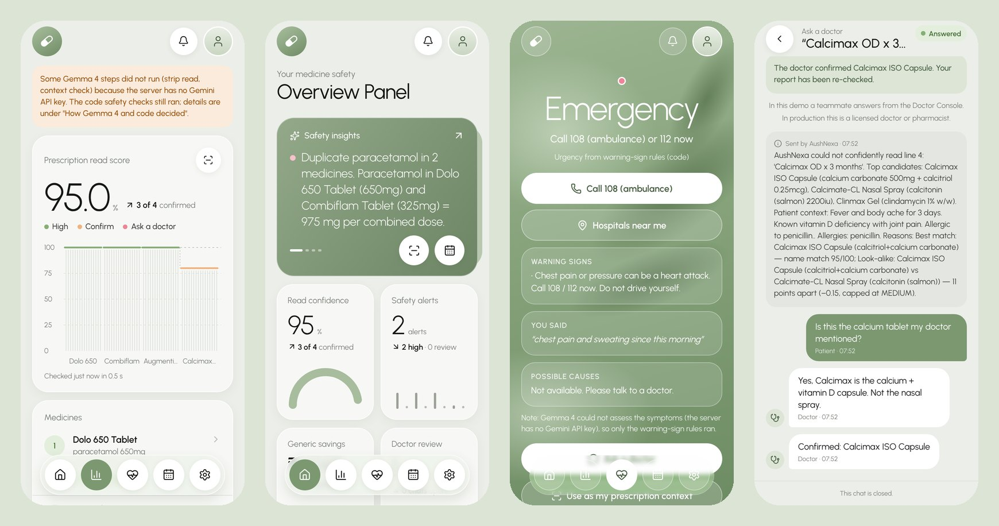
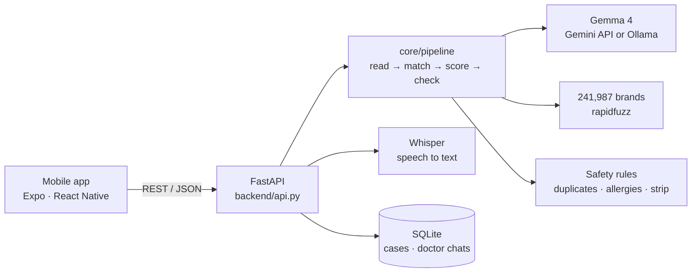
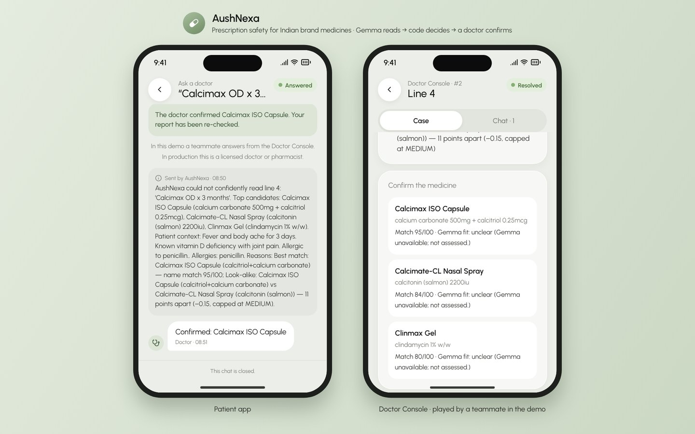

# AushNexa

**Explainable prescription safety for Indian brand medicines: a mobile app on top of Gemma 4.**

Take a photo of a handwritten prescription. Gemma 4 reads it, code matches every brand against 241,987 real Indian medicines and checks for hidden duplicates, allergies and strip mismatches, and a doctor confirms anything the app isn't sure about.

**Gemma reads → code decides → a doctor confirms.**



<sub>Captured from the running app with no Gemini API key on the server. That's why the Gemma steps show as skipped while the code checks still run.</sub>

> ⚠️ AushNexa supports medication review only. The absence of an alert does **not** mean a prescription is safe. It is not a substitute for a doctor or pharmacist, and it has no regulatory approval.

## Why

Indian prescriptions are handwritten and full of brand names. Two brands can hide the same salt: Dolo 650 and Combiflam both contain paracetamol. One smudged letter can turn a real brand into a different real brand. Calcimax (calcium + vitamin D) sits right next to Calcimate-CL (a calcitonin nasal spray) in the brand list. AushNexa catches what a hurried eye misses, and when it isn't sure, it asks a doctor instead of guessing.

## What the app does

| Screen | What you get |
|---|---|
| **Overview** | Safety insights from your latest check, plus read confidence, safety alerts, Jan Aushadhi savings and items waiting for a doctor |
| **New check** | Patient context and allergies, then a prescription **photo** (camera or gallery) or **typed** lines, plus an optional photo of the medicine strip |
| **Report** | Read score with a per-medicine step chart, each medicine's match and salts, safety alerts (duplicate salts, allergy classes, cross-reactivity), the strip check, generic savings, a Hindi summary and a trace of every Gemma call and code check |
| **Medicine** | *Why* the confidence is what it is (look-alike rivals, strength mismatches, reader uncertainty), the top candidates with Gemma 4's fit notes, a candidate picker, and **Ask a doctor** |
| **Doctor chat** | A live chat with the consulting doctor. When the doctor confirms a medicine, the report re-checks itself with no new Gemma call |
| **Symptom check** | Speak (English or Hindi, transcribed by Whisper) or type how you feel. Warning-sign rules in code plus Gemma 4 give possible causes and an urgency level, with *Call 108* and *Hospitals near me* when it matters |
| **Dose schedule** | OD / BD / TDS / SOS / HS / 1-0-1 turned into a daily plan you can tick off |
| **Doctor Console** | The doctor's side: open questions, the prescription photo, candidates, chat, and one-tap confirmation |
| **Settings** | Server address, switch between Gemma 4 on the Gemini API and local Ollama, profile, Safety Test Lab |

## Repository layout

```
backend/          Python: FastAPI REST API over the core engine (Gemma 4, matching, safety rules, Whisper);
                  also serves the website build
mobile/           Expo / React Native app (iOS, Android and web)
run-website.sh    Build the web app and serve everything at http://localhost:8000
docs/             Screenshots
```



## Quick start

You need Python 3.12 and Node.js 22 (the versions this was tested with). On a Mac: `brew install python@3.12 node`.

### Show it on a website (for demos and judging)

One command builds the app for the browser and serves it, together with the API, at **http://localhost:8000**:

```bash
./run-website.sh
```

The first run installs everything, which takes a few minutes; after that it starts in seconds. It opens your browser when ready. Stop it with `Ctrl+C`.



- **On a laptop or projector**, the page shows the app in a phone frame. On a wide screen, a second phone runs the **Doctor Console**, so you can demo the whole ask-a-doctor loop side by side. Press `Cmd+Ctrl+F` for full screen.
- **On a phone's browser**, the app fills the screen.
- **Gemini key:** open `backend/.env` and paste your key after `GEMINI_API_KEY=` (get one at [aistudio.google.com/apikey](https://aistudio.google.com/apikey)). Without it, photos can't be read, but the typed demo and every code check still work.
- **Make the photo demo instant:** a photo read through the Gemini API can take 40–200 s. Run `./run-website.sh --warm` once beforehand. It runs the demo case through Gemma and caches the answers, so during judging the same demo comes straight from the cache.
- **Optional public link:** so judges can open it on their own phones, run `brew install cloudflared`, then `cloudflared tunnel --url http://localhost:8000` in a second terminal. It prints an `https://….trycloudflare.com` address. The app has no login, so stop the tunnel when you're done.

### Run it on a phone (Expo Go)

**1. Backend** (from `backend/`):

```bash
python3 -m venv .venv && .venv/bin/pip install -r requirements.txt
```

```bash
cp .env.example .env    # then paste your key after GEMINI_API_KEY=
```

```bash
.venv/bin/uvicorn api:app --host 0.0.0.0 --port 8000
```

**2. Mobile app** (from `mobile/`):

```bash
npm install
```

```bash
npx expo start
```

Scan the QR code with **Expo Go** on a phone that is on the same Wi-Fi as your computer. The app finds the backend automatically, at your computer's address on port 8000. Press `i` for the iPhone Simulator (needs Xcode) or `w` for a browser.

No Gemini key yet? Choose **Type it** on the New check screen: typed prescriptions don't need Gemma to be read, and every code safety check still runs.

### Try the demo

1. On the Overview, tap **Try the demo case**. This loads a synthetic prescription (fictional doctor and patient) with a penicillin allergy.
2. Analyze it. You get a **duplicate paracetamol** alert (Dolo 650 + Combiflam), a **penicillin allergy** alert (Augmentin contains amoxicillin), and Calcimax flagged as **Please confirm** because of its look-alike.
3. Open Calcimax and tap **Ask a doctor**.
4. In the Doctor Console (the right-hand phone on the showcase page, or **Settings → Doctor Console** on a second device), reply in the chat and confirm *Calcimax ISO Capsule*. The patient's chat and report update within a few seconds.

## How Gemma 4 is used

- **Vision.** Prescription and strip photos go to `gemma-4-26b-a4b-it` through the Gemini API (`google-genai`). The local option is `gemma4:e4b` on Ollama, so photos can stay on the clinic's own machine.
- **Reasoning.** One text call judges whether every candidate brand fits the patient's condition and writes a Hindi summary. A second prompt suggests possible causes and urgency for the symptom check.
- **Guardrails.** Gemma never makes a safety decision; code does. Gemma's own confidence is ignored, because in testing it was confidently wrong once. Code warning-sign rules can only *raise* symptom urgency, never lower it.
- **Latency.** A photo read through the Gemini API took 39–210 s in our tests, so the API runs analyses as background jobs and the app shows each step live. Responses are cached on disk, and a doctor's confirmation re-runs only the code checks.

The details, and evidence from tests on real handwritten prescriptions, are in [backend/README.md](backend/README.md).

## Tests and checks

```bash
cd backend && .venv/bin/python -m pytest -q          # 134 offline tests (set RUN_LIVE=1 to also call Gemma)
```

```bash
cd mobile && npm run typecheck && npm run lint
```

## What's real and what's demo

| Part | Status |
|---|---|
| Gemma 4 calls, brand matching, safety checks, speech to text | Real |
| Brand → salt data | Real: [junioralive/Indian-Medicine-Dataset](https://github.com/junioralive/Indian-Medicine-Dataset) (MIT) |
| Jan Aushadhi prices | **Indicative.** About 12 salts. Verify at janaushadhi.gov.in |
| Doctor | A real person in the chat. **In the demo, a teammate plays the doctor** in the Doctor Console |
| Demo prescription and strip | **Synthetic** images made by `backend/scripts/make_demo_assets.py` |
| Accounts and security | **None.** The API has no authentication. Run it on a trusted network only |

## Who it's for

Pharmacies are the first buyer: a second pair of eyes at the counter. Clinics and telehealth apps can run the same checks on e-prescriptions. Patients get the free tier: the photo check, the Hindi summary and *Ask a doctor*. A production version would need clinical validation, a pharmacist-reviewed dataset, CDSCO medical-device review and compliance with India's DPDP Act 2023.

## Project history

The AushNexa concept comes from team TRIKΛΛL's proposal at the MUJ Hypnexis hackathon (24–25 Oct 2026). The backend was written from scratch on 30 Oct 2026 for the Hacktoberfest 2026 "Best Use of Gemma 4" track, and the mobile app replaced the original Streamlit prototype UI.

## License

MIT (see [LICENSE](LICENSE)). Dataset: MIT (junioralive). Fonts: Urbanist (OFL) in the app; Reenie Beanie (OFL) and Homemade Apple (Apache 2.0) in the synthetic demo prescription.
