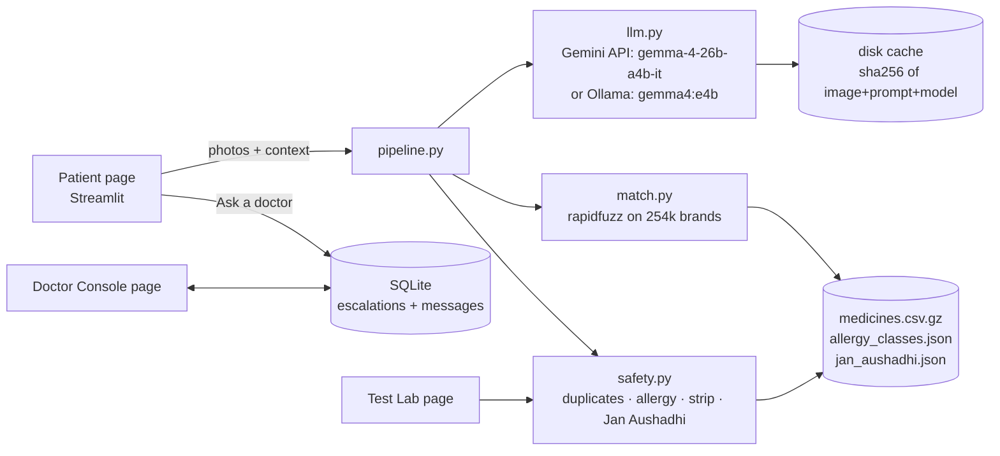

# AushNexa (TBD): build plan

2026-10-30 11:12 IST · Idea: AushNexa, rebuilt from scratch today (inspired by the TRIKΛΛL concept) · Deadline 2026-10-30 14:00 IST · Feature freeze 13:15 IST · Ship buffer 45 min

## Demo storyline (2 min)

| Beat | On screen | Presenter line | Feature that makes it work |
|---|---|---|---|
| 1 | The title page, with a messy handwritten prescription beside it | "Indian prescriptions are handwritten, brand-named and full of hidden duplicates. Dolo + Combiflam means paracetamol twice." | none |
| 2 | Patient context: types "fever and body ache for 3 days; known vitamin D deficiency with joint pain; allergic to penicillin" | "First, Gemma 4 learns what the patient is going through." | CTX-1 patient context (+ report photo read) |
| 3 | Uploads the photo of the prescription. A progress trace shows "Gemma 4 (gemma-4-26b-a4b-it) reading…", then a medicine table with a confidence band for each row | "Gemma reads, then our code checks every name against 254k real Indian brands." | A2 photo read · CONF-1 fuzzy match + confidence · F2 trace |
| 4 | Red alerts: **DUPLICATE paracetamol** (Dolo 650 + Combiflam, 975 mg per dose) and **ALLERGY**: penicillin vs Augmentin (amoxicillin) | "Code, not the model, makes safety calls." | A5 duplicates · A6 allergy class check |
| ★5 | The Calcimax row is **MEDIUM**, not HIGH. Gemma read it correctly despite the ink blot, but a real *different-drug* look-alike exists: **Calcimate-CL** (a calcitonin nasal spray). The "Why?" box shows the look-alike. The patient taps **Ask a doctor**. The Doctor Console (second tab) shows the photo, the top-3 candidates and the patient context. The doctor chats back and confirms "Calcimax ISO". The patient card flips to **✅ Confirmed by doctor**, and only the code checks re-run | "A misread isn't gibberish; it's often a real, different drug. In our handwriting test Gemma once read Calcimax as Celemax, a real antibiotic. So AushNexa never lets a look-alike through silently: one tap and a doctor confirms." | CONF-1 LASA rule · ESC-1 doctor chat |
| 6 | Uploads a photo of the medicine strip the pharmacy handed over: prescribed Dolo **650**, strip says **500** → **MISMATCH** | "And it checks what the pharmacy actually gave you." | F1 strip photo match |
| 7 | Patient output: dose schedule, **Hindi summary**, and **Jan Aushadhi generics, saving ₹X/month** | "In the patient's language, at a price they can afford." | B3 Hindi summary · B2 Jan Aushadhi |
| 8 | The Test Lab page shows 4/4 safety cases passing. A sidebar toggle switches to **local Gemma 4 E4B on Ollama** | "Tested, explainable, and it runs on open weights, so patient data can stay in the clinic." | C2 test lab · F3 Ollama backend |

## Scope

| ID | Item | MoSCoW | Beat | Notes |
|---|---|---|---|---|
| A2 | Prescription photo → Gemma 4 read (raw text, form, strength, frequency, unsure flag) | MUST | 3 | The spike proved the prompt works (21/21 detected) |
| A1 | Typed prescription input (fallback when the API is slow or down) | MUST | 3 | Deterministic, no LLM needed |
| CONF-1 | Fuzzy match to the 254k-brand dataset (top-3), strength-aware, with a confidence score and HIGH/MEDIUM/LOW bands, and the score breakdown shown | MUST | 3, 5 | Gemma's own confidence isn't trusted (Celemax 0.9) |
| CTX-1 | Patient context: symptoms or condition text, plus allergies, plus an optional report photo (Gemma extracts the conditions). Gemma judges whether each medicine fits, using the dataset's `medicine_desc`, and that adjusts confidence | MUST | 2, 3 | The user's request |
| A5/A6 | Safety engine: duplicate salts across and inside combinations, plus allergy class expansion (penicillin, sulfa, NSAID, cephalosporin) | MUST | 4 | Pure Python, unit-tested |
| A10/ESC-1 | LOW or UNSURE → "Ask a doctor" escalation → Doctor Console chat (shared SQLite). The doctor confirms a candidate or types the correct name, and the patient view updates live | MUST | 5 | The user's request: chat, not a call |
| F1 | Strip/box photo → read → match against the prescription: MATCH / MISMATCH (strength) / NOT PRESCRIBED | MUST | 6 | Printed text, so easy for Gemma |
| B2/B3 | Jan Aushadhi generic + ₹ saved (about 30 hand-curated salts, **labelled "indicative"**), plus a Hindi patient summary (Gemma text call, with an English template fallback) | MUST | 7 | |
| F2 | Pipeline trace expander: each Gemma call (model, latency, cache hit) and each code check, with inputs → outputs | SHOULD | 3 | A logged pipeline, *not* claimed as native function calling (too slow at 40 s+ per turn) |
| C2 | Test Lab page: 4 preset typed cases with expected alerts → pass/fail (and the same cases as pytest) | SHOULD | 8 | |
| F3 | `LLM_BACKEND=ollama` → `gemma4:e4b` locally (sidebar toggle) | SHOULD | 8 | The model is downloading now (16 GB M5) |
| B1 | Dose schedule (OD/BD/TDS/SOS/HS decoded into morning, afternoon, night) | SHOULD | 7 | A small lookup table |
| VOICE | Voice symptom check: Whisper (open source, local) → Gemma 4 possible causes + urgency (no diagnosis). Code red flags can only raise the urgency. Call 108/112, a "Hospitals near me" Google Maps link, Ask a doctor, and the transcript feeds the beat-2 context | SHOULD | 2 | Added 11:30 at the user's request. Cut at 12:50 if it isn't solid |
| SUB | README naming `gemma-4-26b-a4b-it`, a LICENSE (MIT), data attribution, and a "built today" note | MUST | n/a | A submission requirement |

**WON'T (this hackathon):** login and portals; delivery, pharmacy orders and GPS maps; the doctor directory and slots; the clinician registry, audit log and telehealth queue; drug-drug interaction database; voice calls; a full-UI Hindi translation; native multi-turn function calling; deploying to the cloud before the demo works locally.

## Architecture



The patient page sends the prescription photo (and the optional report and strip photos) to `pipeline.py`. Gemma 4 calls run **in parallel threads** through `llm.py`, which handles the backend switch, retries with backoff, and the disk cache. The raw readings go to `match.py` (top-3 real brands) and then to the confidence scorer. One Gemma text call judges how well each medicine fits the patient's condition and writes the Hindi summary. `safety.py` makes every safety decision deterministically. An escalation writes to SQLite, and both pages poll it with `st.fragment(run_every=3s)`.

| Component | Real or mocked | Why | How a mock is labelled |
|---|---|---|---|
| Gemma 4 vision and text | Real (Gemini API, with an Ollama option) | The sponsor requirement | n/a |
| Brand → salt data | Real (junioralive/Indian-Medicine-Dataset, MIT) | Credible "any brand" coverage | Attribution in the README and footer |
| Jan Aushadhi prices | Hand-curated, about 30 salts | No machine-readable official list exists | "Indicative price, verify at janaushadhi.gov.in" next to each one |
| Doctor | A real human through the chat, played by a teammate in the demo | Human in the loop is the point | The README and console header say "Demo: a teammate plays the consultant" |
| Demo results | Cached from a real earlier run of the same photos | API latency of 40–210 s | The trace shows "cache hit" |

## Stack

| Layer | Choice (version) | Why |
|---|---|---|
| App | Python 3.12, Streamlit ≥1.40 (multipage, `st.fragment`, `st.camera_input`) | The team knows Python. One process, fastest to a clean UI |
| AI | `google-genai` 2.34 → `gemma-4-26b-a4b-it` (31B as an option) | 26B was more reliable than 31B in the spike |
| Local AI | Ollama 0.40.11 → `gemma4:e4b` (HTTP `/api/chat`) | Open-weights story, and a fallback |
| Matching | `rapidfuzz` 3.x | Fast fuzzy search over about 250k names |
| Data | pandas, a gzipped CSV, SQLite (stdlib) | No server to run |
| Tests | pytest | Test Lab cases double as tests |

## Data model

- **medicines.csv.gz** (preprocessed from `updated_indian_medicine_data.csv`, active rows only): `name, base_name` (form words removed, lowercased), `price, pack, salts` (a JSON list of `{salt, strength}`), `desc` (the first 300 characters of `medicine_desc`).
- **allergy_classes.json**: `{class: [salt keywords]}`, for example `penicillin: [amoxicillin, amoxycillin, ampicillin, cloxacillin, piperacillin…]`.
- **jan_aushadhi.json**: `{salt_signature: {generic_name, price, pack}}`.
- **SQLite `app.db`**:
  - `escalations(id, case_id, med_index, raw_text, candidates_json, context, status[open|resolved], resolution, created_at)`
  - `messages(id, escalation_id, sender[patient|doctor|system], text, ts)`

## Interfaces (the contract between parallel builders)

```python
# core/llm.py
def read_prescription(image: bytes) -> dict        # {"medicines":[{raw_text, brand_or_drug, form, strength, dose_and_frequency, duration, unsure}]}, plus "_trace"
def read_strip(image: bytes) -> dict               # {"brand_or_drug", "strength", "raw_text", "_trace"}
def read_report(image: bytes) -> dict              # {"conditions":[str], "summary": str, "_trace"}
def assess_context(context: str, meds: list[dict]) -> dict  # {"fit":[{"index", "fits":"yes|no|unclear", "reason"}], "hindi_summary": str, "_trace"}
# All four: backend from env LLM_BACKEND (gemini|ollama), 3 retries with backoff, disk cache, never raise (return {"error": ...})

# core/match.py
def candidates(name: str, strength: str | None, k=3) -> list[dict]   # [{name, salts, price, pack, desc, score}]
# core/confidence.py
def score(read: dict, cands: list[dict], fit: str | None) -> dict    # {"value": 0..1, "band": "HIGH|MEDIUM|LOW", "breakdown": {...}}
# core/safety.py
def duplicates(meds: list[dict]) -> list[dict]     # alerts
def allergy(meds: list[dict], allergies: list[str]) -> list[dict]
def strip_check(strip: dict, meds: list[dict]) -> dict  # {"status": "MATCH|MISMATCH|NOT_PRESCRIBED", "detail"}
def jan_aushadhi(med: dict) -> dict | None
def schedule(freq: str) -> list[str]
# core/store.py
def open_escalation(...)->int; add_message(eid, sender, text); messages(eid); resolve(eid, resolution); list_open()
```

**Confidence:**
- Start from the fuzzy score / 100.
- Subtract 0.15 if the gap between the top-1 and top-2 candidates is under 5 points.
- Subtract 0.2 if Gemma marked the item unsure.
- Subtract 0.15 if the strength Gemma read is not in the matched candidate's composition.
- Add 0.1 if the medicine fits the patient's condition, and subtract 0.2 if it doesn't.
- **Bands:** HIGH is ≥ 0.85. MEDIUM is 0.6–0.85, and the patient picks from the top-3 or asks a doctor. LOW is under 0.6, and the item is escalated to a doctor; nothing low is used silently.

## Screens

| Screen | Purpose | Key states |
|---|---|---|
| Patient (`app.py`) | Step 1: context. Step 2: prescription (photo or typed). Step 3: report (medicines table with bands, alerts, Ask a doctor, strip check, schedule, Jan Aushadhi, Hindi, trace) | Empty, reading (progress with elapsed seconds), API error (switch to typed input or cache), awaiting doctor, confirmed |
| Doctor Console (`pages/2_Doctor_Console.py`) | List of open escalations, then chat, then confirm a candidate or type a name | None open, open, resolved |
| Test Lab (`pages/3_Test_Lab.py`) | Run 4 preset cases, then a pass/fail table | Running, all pass, a failure |

## AI and agent design

- **Model:** `gemma-4-26b-a4b-it` through the Gemini API (`GEMMA_MODEL` env var). The fallback is `gemma4:e4b` on Ollama.
- **Prompts:** the spike's prompt with fewer output fields (to cut tokens), plus a strip prompt, a report prompt and an assessment prompt. JSON is extracted with a regex.
- **Guardrails:**
  - Gemma never decides safety.
  - Gemma's own confidence is ignored.
  - "Never invent a medicine."
  - Struck-out items are excluded (proven in the spike).
  - Every result carries the disclaimer "supports review; absence of an alert ≠ safe".
- **Latency:** the 3 vision calls run in parallel, with a progress UI. The cache makes repeat runs instant.
- **Failure:** after 3 retries, show an error card with "Type it instead" and "Use local Gemma (Ollama)".
- **Cost:** free tier.

## Sponsor integrations

| API / SDK | Used for | Access | Rate limits | Fallback if it's down during the demo |
|---|---|---|---|---|
| Gemini API, `gemma-4-26b-a4b-it` (google-genai 2.34) | Reading prescriptions, strips and reports; context fit; Hindi | The AI Studio key (in hand) | Unconfirmed (possibly about 15 RPM). We saw slow responses and 500s | Disk cache, Ollama `gemma4:e4b`, typed input |

## Environment and secrets

| Variable | What it is | Where it comes from |
|---|---|---|
| `GEMINI_API_KEY` | AI Studio key | Already in hand. Kept in `.env`, never committed |
| `GEMMA_MODEL` | Default `gemma-4-26b-a4b-it` | `.env` |
| `LLM_BACKEND` | `gemini` or `ollama` | `.env` or the sidebar toggle |
| `OLLAMA_MODEL` | Default `gemma4:e4b` | `.env` |

## Deploy

- **Live demo:** run locally on the M5 Mac (Ollama needs it anyway), and record the demo video from it. Deploying to Streamlit Community Cloud is a stretch goal, only after the freeze if time is left.
- **Local build:** `uv venv && uv pip install -r requirements.txt && cp .env.example .env && python scripts/build_data.py && streamlit run app.py`

## Timeline

| Milestone | Done when | Target |
|---|---|---|
| M0 Setup | Repo, skeleton, data preprocessed | 11:25 |
| M1 Thin slice | A typed or photo prescription → matched medicines with bands → duplicate and allergy alerts, working end to end | 12:10 |
| M2 MUST complete | Doctor chat escalation, strip check, context fit, Hindi and Jan Aushadhi | 12:45 |
| SHOULD | Trace, Test Lab, Ollama toggle, schedule | 13:05 |
| Demo cache and rehearsal | Demo photos run once and cached; one full rehearsal | 13:15 |
| Feature freeze | Only fixes after this | 13:15 |
| Ship buffer | README, video, submission form (`/hack-ship`) | 13:15–13:55 |
| Deadline | Submitted | 14:00 |

## Risks

| Risk | Likelihood | Impact | Mitigation | Cut-scope trigger |
|---|---|---|---|---|
| Gemini API Gemma latency (40–210 s) and 500s | High | High | Parallel calls, retries, disk cache, Ollama fallback, typed input | Any rehearsal call over 60 s → demo from cache |
| Scope too big for about 1 h 50 min of build | High | High | Parallel builders against fixed interfaces; MUST before SHOULD | 12:45 with MUST unfinished → drop F3, then C2, then B1 |
| The fuzzy match picks the wrong brand | Med | Med | Strength-aware ranking, top-3 shown, MEDIUM/LOW bands, doctor confirmation | n/a |
| Streamlit live updates in the doctor chat | Med | Med | `st.fragment(run_every=3)`; a manual "Refresh" button as a fallback | n/a |
| Rules: building on a project from another hackathon | Med | High | New repo, all code written today, the README credits the concept and states that | Ask the organisers before submitting |
| Medical liability | Med | High | "Supports review", never says "safe", the doctor confirms LOW items, the Jan Aushadhi price is labelled indicative | n/a |
| Ollama E4B is slow or poor on 16 GB | Med | Low | It is only a SHOULD toggle | Drop F3 if it doesn't work by 12:50 |
| Demo photo licensing | Low | Med | The team writes or photographs its own prescription and strips (not the HF samples) | n/a |

From docs/IDEAS.md, the skeptic objections and how this plan answers them:
- **Handwriting reliability:** read → match → confirm, with doctor escalation.
- **Brand vs generic names:** salt-level matching from the dataset.
- **"Never say safe":** guardrail above.
- **Scope:** the tablet-count check is cut.

## Submission checklist

| Requirement | Owner | When | Done |
|---|---|---|---|
| Uses Gemma through the Gemini API, shown in the demo and the code | Build | 12:10 | |
| README names `gemma-4-26b-a4b-it` | Ship | 13:30 | |
| Public repo with an MIT LICENSE and dataset attribution | Ship | 13:30 | |
| Demo video / live demo (format UNKNOWN; confirm with the organisers) | Team | 13:45 | |
| Submission form / write-up (platform UNKNOWN) | Team | 13:55 | |

## Review changes

From docs/reviews/plan-skeptic.md (verdict: serious), revised at 11:14:

1. **The star beat used a real wrong drug.** "Celemax" is a real brand (cefuroxime). Beat 5 is now "the misread is a real but wrong antibiotic, and we catch it". Two new deterministic rules in CONF-1:
   - **Look-alike/sound-alike (LASA) rule.** Candidates are grouped by salt signature first, so duplicate rows and forms don't count as rivals. If a *different-salt* brand scores within 12 points of the top match, cap the band at MEDIUM. If that also comes with fit=no or Gemma unsure, the band is LOW.
   - **Cross-reactivity rule.** A penicillin allergy plus a cephalosporin gives a REVIEW caution.
   - At 11:50 the demo prescription runs through Gemma once, and the demo asset is adjusted until beat 5 lands.
2. **Latency:**
   - Every call has a 90 s timeout and at most 2 Gemma calls run at once.
   - `assess_context` is called **once per case with every top-3 candidate**, so a doctor's correction re-runs only the code checks, never Gemma.
   - Demo cache warming moves to 12:15. Prompts are frozen after that.
3. **Scope cuts:**
   - The report *photo* moves to SHOULD; typed context is MUST.
   - Jan Aushadhi covers about 12 salts (the demo ones plus common ones).
   - Test Lab stays as pytest; the page is SHOULD.
   - The Ollama toggle stays SHOULD.
   - We keep Gemma's condition-fit scoring, because the user asked for it.
4. **Data:** salts are parsed from `short_composition1/2` (already done in DATA-1), since `salt_composition` and `medicine_desc` are mostly empty. The fit check relies on the salt names, with the description when present.
5. **Owners:**
   - Demo assets are synthetic images generated by Claude.
   - The rules question and the submission platform belong to the user's team (ask the organisers now).

Accepted risk: the Streamlit `st.fragment` polling and the speed of rapidfuzz over 242k names (both judged manageable).
